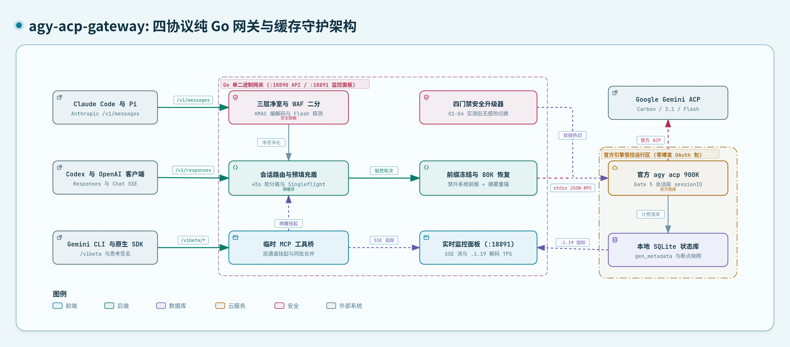
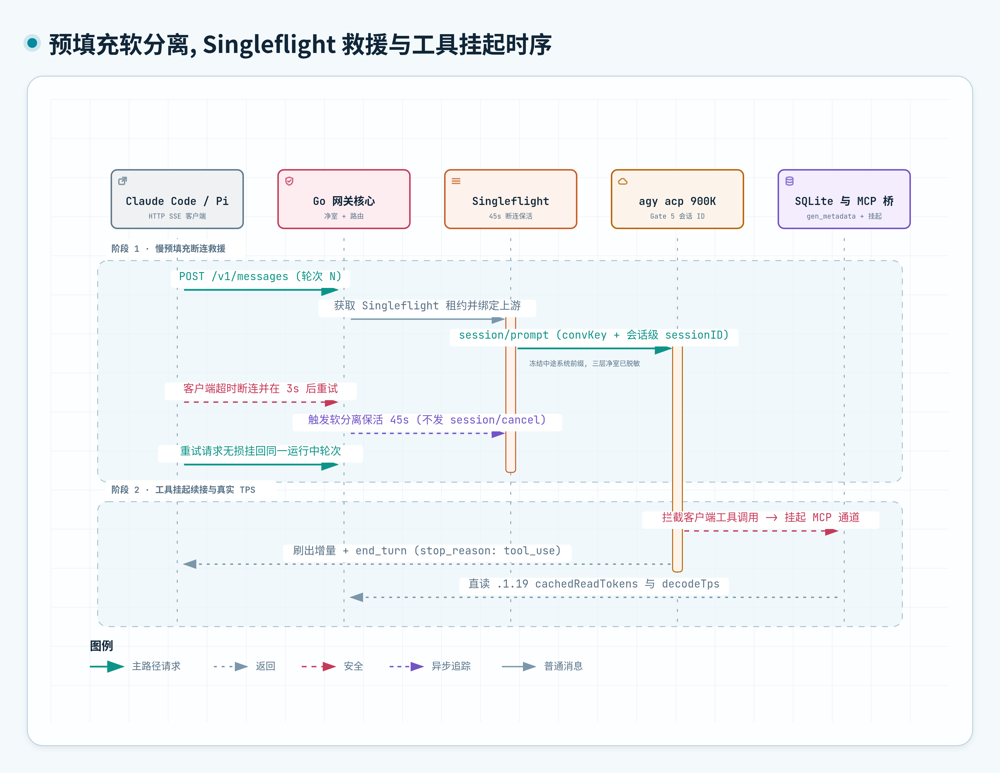
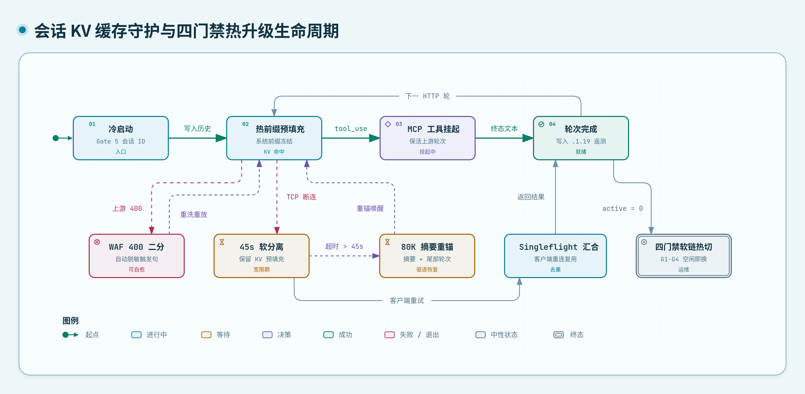

<p align="center">
  <picture>
    <source media="(prefers-color-scheme: dark)" srcset="assets/banner-zh-dark.svg" />
    
  </picture>
</p>

<h3 align="center">基于官方 <code>agy acp</code> 的零 CGO 纯 Go 四协议网关，内置五层 Carbon KV 缓存守护、可逆净室自愈与实时可观测面板。</h3>

<p align="center">
  <a href="./README.md"><strong>English</strong></a> &nbsp;·&nbsp;
  <a href="./README_ZH.md"><strong>简体中文</strong></a> &nbsp;·&nbsp;
  <a href="#工程特色总览"><strong>工程特色</strong></a> &nbsp;·&nbsp;
  <a href="#客户端兼容矩阵"><strong>客户端适配</strong></a> &nbsp;·&nbsp;
  <a href="#快速开始"><strong>快速开始</strong></a> &nbsp;·&nbsp;
  <a href="#配置与指标参考"><strong>配置参考</strong></a> &nbsp;·&nbsp;
  <a href="#四门禁安全升级"><strong>安全升级</strong></a> &nbsp;·&nbsp;
  <a href="#版本更新记录"><strong>更新记录</strong></a>
</p>

<p align="center">
  
  
  
  
  <a href="LICENSE"></a>
</p>

---

**agy-acp-gateway** 是一个**零 CGO 依赖 (`CGO_ENABLED=0`)、单二进制**的纯 Go 多协议 API 网关与实时可观测套件，专门将 Google 官方 Antigravity CLI (`agy acp`，stdio JSON-RPC 2.0) 无缝暴露为标准 HTTP/SSE 接口。

与直接逆向 Google 私有 Protobuf / OAuth 接口裸发请求的代理不同，本网关**100% 严格通过官方 `agy acp` 进程出站通信**。所有 TLS 指纹、OAuth 令牌刷新、轨迹快照与协议帧完全托管于官方二进制内部，在此基础上，网关补齐了四协议原生转换、高并发与长预填充下的五层 KV 缓存守护、可逆语义净室与 WAF 二分自愈、`.1.19` 灰度漂移自愈及无停机软链热更新。

<p align="center">
  <picture>
    <source media="(prefers-color-scheme: dark)" srcset="assets/arch-overview-zh-dark.png" />
    
  </picture>
</p>

---

<a id="工程特色总览"></a>

## 为什么选择 `agy-acp-gateway`？

在真实多 Agent 编程工作流中（`Claude Code`、`Pi`、`Codex CLI`、`Cursor`、`Cline`、`OpenCode`、`Gemini CLI`），常见薄包装或裸逆向代理往往会在长上下文、高并发与多工具调用下踩中以下痛点：

| 生产痛点 | 薄包装 / 裸逆向代理的表现 | `agy-acp-gateway` 工程化方案 |
| :--- | :--- | :--- |
| **裸发 OAuth/Protobuf 风控** | 伪造私有 Protobuf 报文与自定义指纹，极易触发协议层拦截 | **100% 官方 `agy acp` 传输边界**：TLS、OAuth 续签与帧序列化全由官方进程执行 |
| **Carbon 并发持续 0% 缓存** | 复用固定空占位 `sessionID`，或中途篡改 `system`/`developer` 前缀 | **Gate 5 二进制补丁**按每条 `TrajectoryId` 注入 64 位 FNV-1a `sessionID` 并冻结首轮系统前缀 |
| **120-180s 预填充断连雪崩** | 客户端超时重连即刻发 `session/cancel`，十万级在途计算清零 | **45s 预填充软分离 + Singleflight 汇合**保活上游计算，重试直接无损挂回同一轮次 |
| **中途动态加载工具清缓存** | `ToolSearch` 等扩展工具目录时强制重建会话 | **`TOOLS_UPDATED_IN_PLACE` 原地更新**工具声明，保持 92%+ KV 前缀继续命中 |
| **多工具并发 `0/0` 空转** | 同批多个工具调用拆成多次空白来回轮次，或孤儿接力死循环 | **`PlannerResponse` 兄弟合并 + `AGY_MAX_TOOL_RELAYS=4`** 单轮合并返回并截断孤儿接力 |
| **客户端特征句触发 400/429 WAF** | 直接 400/429 报错崩溃，或粗暴正则误删用户规则、路径与标签 | **三层语义净室 + 会话级 HMAC 编解码 + Flash 自动二分**，双向无损还原并沉淀屏蔽规则 |
| **隐式灰度降级与虚高流速监控** | 上报 350+ tok/s 伪爆速，无法察觉暗切降级池或客户端归属 | **纯 Go 零锁 SQLite `.1.19` 解析器**直读权威缓存命中数、实际 `servedModel`、对齐 TTFT 与纯净 `decodeTps` |

---

## 核心工程能力详解

### 1. 五层 Gemini 4 Carbon KV 缓存防御与断连救援

在 100K-400K 长上下文下，Gemini 4 Carbon 的预填充阶段通常需要 90-180 秒，极易超出客户端 CLI 或反向代理的等待阈值而断连重试。网关通过五层联动守住上游前缀缓存：

<p align="center">
  <picture>
    <source media="(prefers-color-scheme: dark)" srcset="assets/seq-prefill-zh-dark.png" />
    
  </picture>
</p>

- **Gate 5 多架构会话级 `sessionID` 注入 (`tools/agy_extra_patch.py`, `SPEC_VERSION=2`)**：跨多架构 ELF 与 Mach-O 二进制（`linux_amd64`、`linux_arm64`、`darwin_arm64`）定位并修补 `codeassistclient.(*CodeAssistClient).getStreamingTextCompletion`（含修补点后寄存器存活校验与 macOS 签名重签），为每条轨迹写入有符号 64 位 FNV-1a 唯一 `sessionID`，彻底消除多客户端并发时的后端缓存键碰撞。
- **中途前缀冻结与 `/compact` 连续统计**：粘性轮次严格冻结首轮后的 `system` / `developer` 段落，防止动态系统提示戳穿 100K+ 缓存树；检测到客户端 `/compact` 或摘要翻转时保留规范会话身份与累计消耗统计 (`agy_gateway_compaction_rollovers_total`)。
- **工具目录原地热扩展与保缓存 `tool_choice`**：当 `Pi` / `Claude Code` 在对话中途动态扩展工具（如 `ToolSearch`）时原地刷新声明 (`TOOLS_UPDATED_IN_PLACE`)；同时在 MCP 桥内部按轮次执行 `tool_choice`（`"none"`、`"required"`/`"any"`、指定单工具、`allowed_tools` 及 Gemini `toolConfig.functionCallingConfig`）而不裁剪会话级工具目录，中途切换模式仍保持 92%-98% 高命中。
- **预填充软分离 (`30s` / `45s`) + Singleflight 去重汇合**：轮次进入上游预填充超过 `AGY_PREFILL_CANCEL_MIN_ELAPSED_SEC=30` 后若客户端断开 TCP，网关进入 `45s` (`AGY_PREFILL_CANCEL_GRACE_SEC`) 宽限期 (`PREFILL_SOFT_DETACH`) 暂不取消上游任务；客户端重连后经 Singleflight 直接复用在途结果 (`PREFILL_SOFT_DETACH_JOIN`)。
- **缓存熔断预警与容量自动降档**：当上下文达到 `>= 80,000` Token (`AGY_CACHE_WARN_MIN_TOKENS`) 且连续 3 轮零缓存时，全协议统一注入非阻断 `X-Agy-Cache-Warning` 响应头；`gemini-4-carbon-high` 连续慢首字丢缓存时自动原地切换至 `medium` 档位 (`HIGH_TIER_CACHE_DEGRADE_FALLBACK`) 恢复稳定吞吐。
  > **上游特性说明**：Gemini 4 Carbon 在上游 (`daily-cloudcode-pa`) 采用隐式前缀缓存管理，高负载队列波动或后端多副本切换仍偶发孤立的冷计算轮次（网关保持每跳完全一致的 `sessionID` 与前缀字节，长会话常态可维持 92%-98.8% 高命中）。

<p align="center">
  <picture>
    <source media="(prefers-color-scheme: dark)" srcset="assets/lifecycle-cache-zh-dark.png" />
    
  </picture>
</p>

### 2. 双通道 MCP 工具挂起桥与兄弟批处理

- **内存双通道挂起 (`mcp_bridge.go`)**：通过 `_meta["antigravity/alwaysLoad"]=true` 注入临时 `ws-bridge` MCP 服务，当模型触发工具调用时即时挂起上游 ACP 状态 (`MCP_TOOL_PARKED`) 并将结果归还下游客户端。
- **兄弟工具单轮合批 (`MCP_TOOL_SIBLINGS_BATCHED`)**：解析 `CortexStepPlannerResponse` 步结构，将同一推理步产生的并行兄弟调用（例如同时并发多个 `Read`、`Grep`、`Edit` 或 `Bash`）合并到单次 HTTP `tool_use` 响应中，消灭无效的 `0/0` 空白中转跳数。
- **孤儿接力限流与热唤醒恢复**：限制客户端遗弃场景下的 `ws_await_result` 轮询上限 (`AGY_MAX_TOOL_RELAYS=4`, `AGY_PARKED_TTL_SEC=300`)；空闲 Worker 按默认 `AGY_IDLE_WORKER_TTL_SEC=1200`（20 分钟，对齐 `agy` 内置 270 秒无状态保活周期）经 `session/close` 休眠并在下次请求通过 `session/resume` 热唤醒，MCP `tools/call` 全程保留 64 位大整数精度（`> 2^53`），已被上游淘汰的会话通过 UTF-8 安全的 80K 字符边界摘要重锚继续对话。
- **零消耗保活快应 (`KEEPALIVE_SKIP_BUSY`)**：会话忙碌期间收到客户端标题探活或后台心跳请求时原地快应 (`keepalive_fast_ack`)，零上游消耗且不打断当前推理前缀。

### 3. 三层语义净室、HMAC 双向可逆编码与 Flash WAF 自动二分

- **无损语义净室 (`outbound_cleanroom.go`)**：剥离 `x-anthropic-billing-header` 等客户端指纹头并对齐官方 `ws-bridge` 身份模板，同时完整保留代码与统一 Diff 首行缩进、用户项目规范、自定义指令、工作区路径与代码符号。
- **会话级 HMAC-SHA256 可逆编解码 (`reversible_codec.go`)**：按会话密钥将受敏工具名、MCP `tools/list` 参数键与描述、片段标识及 XML 标签编码为定长无碰撞密文标签 (`wsseg_*`、`wstag_*`)，在流式增量与 `tools/call` 往返间双向还原，并对结构化输出 JSON Schema 文档注释自动执行净室脱敏。
- **400/429 WAF 自动二分自愈 (`waf_autobisect.go`)**：识别首轮秒级 429 重试环 (`WAF_FAST_CANCEL`)，零人工干预调用 `gemini-3.8-flash-low` (`util:waf-bisect-*`) 对系统样板句做二分排查，定位精确触发句并持久化到 `waf_rewrite_rules.json` (`WAF_AUTOBISECT_HEALED`) 后无缝重试恢复当前轮次 (`waf_autobisect_recovery`)。

### 4. `.1.19` 权威 SQLite 遥测、Argon 影子池恢复与暖纸控制台

- **纯 Go 零锁 SQLite Protobuf 解析 (`sqlite_protobuf.go`)**：依托 `modernc.org/sqlite` 通过 `ReadLatestStepFromSQLiteFast` O(1) 尾部索引查询直接解码本地会话库（与全量解析结果 100% 一致性校验），双游标 (`LastSeenGenMetaIdx` / `LastSeenDbStepIdx`) 避免重复记账。
- **真首字延迟 (TTFT) 对齐与双口径 TPS**：在首字输出前发送 W3C SSE 注释帧 `: ping\n\n` 保活代理而不提前污染首 Token 时间（响应发出后再发标准 `event: ping`）；分别统计全流程端到端吞吐 `tps` 与纯解码流速 `.1.12 decodeTps`，杜绝 350+ tok/s 假峰值。
- **`.1.19` 灰度漂移识别与 Argon 影子池自动恢复**：实时读取 `gen_metadata` `.1.19 servedModel` 字段；当检测到上游隐式路由至降级影子池时，自动记录指标 (`agy_gateway_argon_degradation_detected_total`) 并在当轮透明重放恢复满血模型 (`agy_gateway_argon_degradation_recovered_total`)。
- **确定性 Token 计量与 12+ 客户端全链路归属 (`client_detect.go`)**：`/v1/messages/count_tokens` 与 `/v1beta/models/*:countTokens` 剔除冗余 Base64 字节、将每张图像按 `1,600` Token 稳定折算并计入结构化输出 Schema 指令开销；联合 HTTP Header、净室前系统提示词与历史工具库自动识别 `Claude Code`、`Pi`、`Codex`、`OpenClaw`、`Kilo Code`、`Roo Code`、`Cline`、`OpenCode`、`Cursor`、`Gemini CLI`、`Aider`、`Cherry Studio` 与 `DSH`。
- **暖纸实时控制台与双池额度标定 (`dashboard.go`, `webui/`)**：隔离运行在 `:18891` (`AGY_DASH_PORT`)，通过官方 `agy -p /usage` 同步 5 小时与 7 天双窗口配额，同时支持只读合并 Antigravity 桌面端（`~/.gemini/antigravity/conversations`，`AGY_APP_CONV_DIR`）与宿主机独立 `agy` CLI 的生成步遥测（`AGY App` / `AGY CLI` 独立归属），结合 99% 缓存与 0% 冷跑折算当前可跑 Token 余量与瓶颈提示，并暴露完整 Prometheus `/metrics`。

### 5. 四协议接入 (`:18890`)、统一结构化输出与双端口严格隔离 (`:18891`)

| 端口 | 职责定位 | 暴露路径 |
| :--- | :--- | :--- |
| **`:18890`** (`AGY_GW_PORT`) | **多协议推理与健康探活** | `POST /v1/messages`、`POST /v1/messages/count_tokens`、`POST /v1/chat/completions`、`POST /v1/responses`、`GET /v1/models`、`GET /v1beta/models`、`POST /v1beta/models/{model}:generateContent` / `:streamGenerateContent` / `:countTokens`、`GET /healthz` |
| **`:18891`** (`AGY_DASH_PORT`) | **运维面板与遥测导出** | `GET /` (暖纸实时面板)、`GET /api/dashboard`、`GET /api/upgrade`、`POST /api/upgrade/approve`、`GET|POST|DELETE /api/accounts*`（多账号管理，仅主 Key）、`GET /metrics` (Prometheus)、`GET /health` |

- **四协议统一结构化输出 (Structured Output)**：原生支持 `output_config.format`（`/v1/messages`）、`response_format`（`/v1/chat/completions`）、`text.format`（`/v1/responses`）与 `generationConfig.responseSchema` / `responseMimeType`（`/v1beta`），通过轮次尾部指令注入，不改动粘性系统前缀，兼顾热会话与 MCP 工具挂起续接。
- **有状态续写安全拒止与流式前 JSON 错误返回**：`/v1/responses` 固定标记 `"store": false`，拒绝非空 `previous_response_id`（返回 `400 previous_response_not_found`），且在 `stream: true` 首包发出前报错时保持 `application/json` 返回（避免过早切入 `text/event-stream`）；`/v1/messages` 与 `/v1/messages/count_tokens` 拒绝 `thread` 字段（返回 `404 thread_not_found`），引导客户端重发完整上下文而不静默丢历史。
- **双端口严格隔离**：运维与监控路径（`/`、`/dashboard`、`/api/*`、`/metrics`）在 `:18890` 上一律返回 `404`；推理与 MCP 桥路径（`/v1/*`、`/v1beta/*`、`/mcp/*`）在 `:18891` 上一律返回 `404`。

### 6. 单通道多模态 v2、管道防死锁与错误/许可证隔离

- **三阶段多模态规范化流水线 (`multimodal_normalize.go`, `image_fetcher.go`)**：统一适配四协议与两套 `count_tokens`，通过 16 字节魔数校验放行 `PNG`/`JPEG`/`WEBP`/`GIF` 与 `<= 2MB` UTF-8 文本附件，彻底修复 `tool_result` / `role: "tool"` / `function_call_output` / `functionResponse.parts` 嵌套图片丢失问题。采用未导出内存哨兵类型 (`canonicalImageStamp`) 阻断客户端伪造 `decodedBytes` / `digest` / `_canonical` 绕过首阶段校验，历史已验真内联图片经 SHA-256 元数据缓存加速；不支持模态与超限均在流式前返回精确 `400`/`413`，外链图片仅对新增轮次惰性拉取（内置 `64MB/15m` LRU、`singleflight` 与覆盖 IPv4 映射/过渡 IPv6 地址段的 `net.Dialer.Control` 内核态反 SSRF）。
- **底座内存与管道防死锁 (`acp_engine.go`, `main.go`)**：网关默认采用 `GOMEMLIMIT=256MiB`（并单独隔离 `AGY_CHILD_GOMEMLIMIT=180MiB`），采用 `128MB` 上限的 `ReadSlice('\n')` 行读取器与 `56MB` 出站帧守卫，并在引擎关闭时向 `-cmd.Process.Pid` 进程组发送 `SIGKILL` 防止子进程继承管道导致 `cmd.Wait()` 死锁。
- **许可证 (`#3501` / 企业席位)、配额快停与动态 `Retry-After`**：上游 `#3501`、`GEMINI_ENTERPRISE_LICENSE_NOT_VALID` 与 `ccpa_ineligible_tier_id` 错误固定映射为 `403 permission_error` / `PERMISSION_DENIED` 且不重试、不跨模型漂移、不误触 ToS 熔断；消费上限/预付耗尽/日周额度触顶等硬配额 `429` 在 `<1s` 内直接快停（跳过无效二分）；瞬态容量 `429`/`529` 自动从上游重置提示解析并注入有界 `Retry-After` 头（`5s..3600s`）；内容安全策略拦截（`SAFETY`、`PROHIBITED_CONTENT`、`RECITATION`、`SPII`）直接返回不可重试 `400`。控制台同时提供 `排队首字 / 思考 / 可见生成` 三段耗时拆解、`Retry xN` 徽章与可选四门禁对话文件清理 (`AGY_CONV_KEEP_DAYS`)。

---

<a id="客户端兼容矩阵"></a>

## 客户端兼容矩阵

| 客户端 / SDK | 接入协议 | 已验证能力 | 会话与缓存保障机制 |
| :--- | :--- | :--- | :--- |
| **Claude Code** | `POST /v1/messages` | 流式 `thinking` + `signature`、`output_config.format` 与 `effort`、`tool_use` 挂起续接、`/compact` 识别 | 自动剥离计费头与改写 `<user-excerpt>`；压缩后完整保留源会话与累计统计 |
| **Pi Agent** | `POST /v1/messages` | 同批多工具单轮并发 (`PlannerResponse` 合并)、`ToolSearch` 动态工具热加载、思考档位映射 | 由 `TOOLS_UPDATED_IN_PLACE` + 45s 软分离 + Singleflight 联合守护长程循环 |
| **Codex CLI** | `POST /v1/responses` | 流式 `reasoning` 与 `reasoning_summary_text.delta`、`function_call` 与 `custom_tool_call`、`text.format` | `store: false`（`400 previous_response_not_found` 安全守卫）；粘性轮次冻结中途 `developer` 前缀 |
| **Cursor / Cline / Roo / OpenCode** | `POST /v1/chat/completions` | `reasoning_content`、`response_format` (`json_schema`)、`tool_calls`、保缓存 `tool_choice` | 会话级 `HMAC-SHA256` 双向映射与孤儿工具接力熔断 (`AGY_MAX_TOOL_RELAYS=4`) |
| **Gemini CLI / `@google/genai`** | `POST /v1beta/models/*` | `:generateContent`、`:streamGenerateContent?alt=sse`、`:countTokens`、`responseSchema`、`toolConfig`、`?key=`/`/key=` 鉴权 | 确定性 FIFO 无 `id` 工具调用重绑定与 `thoughtSignature` 原生透传 |

---

## 支持模型与思考档位映射

`/v1/models`（含 `context_window`、`max_input_tokens` 与 `max_tokens: 65536`）与 `/v1beta/models`（含 `inputTokenLimit` 与 `outputTokenLimit: 65536`）默认返回 7 个 canonical 模型 ID（设置 `AGY_EXPOSE_TIER_MODELS=1` 可展开档位后缀）。请求支持携带 `-minimal`、`-low`、`-medium`、`-high`、`-xhigh`、`-max`、`-ultra` 后缀（`-minimal` 映射为 `low`；`-xhigh`/`-max`/`-ultra` 在 `gemini-4-neon` 与 `gemini-4-hydrogen` 上映射为 `xhigh`，其余模型自动收敛至 `high`），或使用各协议标准推理字段（`output_config.effort`、`thinking.budget_tokens`、`reasoning_effort`、`reasoning.effort`、`thinkingConfig.thinkingLevel` / `thinkingBudget`）：

| Canonical 模型 ID | 常用别名示例 | 思考档位 | 最大上下文 (已解锁) |
| :--- | :--- | :--- | :--- |
| `gemini-4-carbon` *(默认)* | `carbon`、`gemini-4-carbon-*` | `low`, `medium`, `high` | **900K+** (`1,048,576` API) |
| `gemini-4-neon` | `neon`、`gemini-4-neon-*` | `low`, `medium`, `high`, `xhigh` | **900K+** (`1,048,576` API) |
| `gemini-4-argon` | `gemini-4-pro`、`argon`、`gemini-4-argon-*` | `low`, `medium`, `high` | **900K+** (`1,048,576` API) |
| `gemini-4-hydrogen` | `hydrogen`、`gemini-4-hydrogen-*` | `low`, `medium`, `high`, `xhigh` | **900K+** (`1,048,576` API) |
| `gemini-3.8-flash` | `gemini-flash`、`gemini-3.8-flash-*` | `low`, `medium`, `high` | **900K+** (`1,048,576` API) |
| `claude-opus-5-5` | `agy-opus`、`claude-opus-5-*` | `low`, `medium`, `high` | **900K+** (`1,048,576` API) |
| `claude-sonnet-5-5` | `agy-sonnet`、`claude-sonnet-5-*` | `low`, `medium`, `high` | **900K+** (`1,048,576` API) |

---

<a id="快速开始"></a>

## 快速开始

### 环境前置要求

- **Go 1.26+**（用于 `CGO_ENABLED=0` 零依赖静态编译）
- **Python 3.10+**（用于在 `linux_amd64` / `linux_arm64` / `darwin_arm64` 上执行 Gate 1-5 多架构 ELF/Mach-O 补丁及隔离 ACP 契约校验脚本）
- **Google Antigravity CLI (`agy`)**：已在本机安装并完成登录（`agy auth login` 或存在有效 `~/.gemini/antigravity-cli/antigravity-oauth-token`）

### 1. 编译纯 Go 网关并生成 `bin/agy-acp-900k`

```bash
git clone https://github.com/yuhxuiao/agy-acp-gateway.git
cd agy-acp-gateway
mkdir -p bin backups logs runtime

# 运行竞态检测全套单测并编译零 CGO 单二进制
cd go-gateway
gofmt -l . && go vet ./... && go test -race -count=1 ./...
CGO_ENABLED=0 go build -trimpath -ldflags="-s -w" -o ../bin/agy-acp-gateway .
cd ..

# 对本机官方 agy 执行 Gate 1-5 补丁并完成离线 ACP 契约验收
scripts/agy-upgrade.sh --official ~/.local/bin/agy --contract
scripts/agy-upgrade.sh --install --candidate runtime/upgrades/candidates/<candidate-id>
```

> 免编译安装网关：也可直接从 [GitHub Releases](https://github.com/yuhxuiao/agy-acp-gateway/releases) 下载对应平台（`linux/amd64`、`linux/arm64`、`darwin/amd64`、`darwin/arm64`）的预编译 `agy-acp-gateway` 压缩包并校验 `SHA256SUMS` 放入 `./bin/`，再在本地用 `third_party/agy-context-unlock/agy-patch.py` 与 `tools/agy_extra_patch.py` 将官方 `agy` 补丁生成 `./bin/agy-acp-900k`。

### 2. 配置与本地启动

```bash
cp .env.example .env
# 按需修改 .env 中的 AGY_API_KEYS、代理或缓存阈值参数

scripts/gw.sh start
scripts/gw.sh status
scripts/gw.sh logs
```

- **网关 API 入口**：`http://127.0.0.1:18890`（`GET /healthz`）
- **实时监控面板**：`http://127.0.0.1:18891/`（`/metrics`、`/health`、`/api/dashboard`）

### 3. Docker Compose 容器化部署

```bash
# 确保 ./bin/agy-acp-gateway 与 ./bin/agy-acp-900k 已生成就位
cp .env.example deploy/.env
docker compose -f deploy/docker-compose.yml up -d --build
curl -fsS http://127.0.0.1:18890/healthz
```

<details>
<summary><strong>客户端接入示例 (Claude Code / Codex / OpenAI Chat / Gemini CLI)</strong></summary>

#### Claude Code (`/v1/messages`)

```bash
export ANTHROPIC_BASE_URL="http://127.0.0.1:18890"
export ANTHROPIC_API_KEY="sk-agy-replace-with-your-secret-key"
export ANTHROPIC_MODEL="gemini-4-carbon-medium"
export ANTHROPIC_SMALL_FAST_MODEL="gemini-3.8-flash-low"
claude
```

#### Codex CLI / OpenAI Responses (`/v1/responses`)

```bash
curl -sS http://127.0.0.1:18890/v1/responses \
  -H "Content-Type: application/json" \
  -H "Authorization: Bearer $AGY_API_KEY" \
  -d '{
    "model": "gemini-4-carbon",
    "reasoning": {"effort": "medium"},
    "input": "Summarize the benefits of pure-Go SQLite readers."
  }'
```

#### OpenAI Chat Completions (`/v1/chat/completions`)

```bash
curl -sS http://127.0.0.1:18890/v1/chat/completions \
  -H "Content-Type: application/json" \
  -H "Authorization: Bearer $AGY_API_KEY" \
  -d '{
    "model": "gemini-4-argon",
    "reasoning_effort": "high",
    "stream": true,
    "messages": [{"role": "user", "content": "Write a concurrent worker pool in Go."}]
  }'
```

#### Google Gemini CLI 与 REST SDK (`/v1beta`)

```bash
export GOOGLE_GEMINI_BASE_URL="http://127.0.0.1:18890"
export GEMINI_API_KEY="sk-agy-replace-with-your-secret-key"

curl -sS "http://127.0.0.1:18890/v1beta/models/gemini-4-carbon:streamGenerateContent?alt=sse" \
  -H "Content-Type: application/json" \
  -H "x-goog-api-key: $GEMINI_API_KEY" \
  -d '{
    "generationConfig": {"thinkingConfig": {"thinkingLevel": "HIGH"}},
    "contents": [{"role": "user", "parts": [{"text": "Explain ACP warm session resumption briefly."}]}]
  }'
```

</details>

---

<a id="配置与指标参考"></a>

## 配置项与 Prometheus 指标参考

<details>
<summary><strong>环境变量完整说明 (核对自 <code>go-gateway/internal/config/snapshot.go</code>、<code>go-gateway/config.go</code> 与 <code>.env.example</code>)</strong></summary>

| 变量名 | 默认值 | 说明 |
| :--- | :--- | :--- |
| `AGY_LISTEN_HOST` | `127.0.0.1` | 网关 API 与监控面板监听地址 |
| `AGY_GW_PORT` / `AGY_DASH_PORT` | `18890` / `18891` | API 服务端口与隔离的监控看板端口 |
| `AGY_API_KEYS` / `AGY_API_KEYS_FILE` | *(空)* | 逗号分隔或文件密钥，覆盖 `/v1/*`、`/v1beta/*`（`?key=`/`/key=`）及 `:18891`（Bearer / `x-api-key` / 浏览器 HTTP Basic 密码，常时间比较） |
| `AGY_CORS_ORIGINS` | *(空)* | 允许跨域来源（自动放行 `X-Agy-Served-Model` 与 `X-Agy-Cache-Warning` 暴露头） |
| `AGY_ACP_BIN` | `<root>/bin/agy-acp-900k` | Gate 1-5 修补后的多架构 `agy` 可执行文件路径（`linux_amd64`、`linux_arm64`、`darwin_arm64`） |
| `AGY_UPSTREAM_PROXY` | *(二进制默认空; `.env.example` 为 `127.0.0.1:7890`)* | 透传给 `agy acp` 子进程与 `/usage` 额度同步的代理地址 |
| `AGY_MAX_LIVE_WORKERS` / `AGY_MAX_CONCURRENT_PROMPTS` | `8` / `6` | 共享 `agy acp` 多路复用器最大常驻会话数与并发 LLM 推理槽位 |
| `AGY_MAX_PROBE_WORKERS` | `1` | 后台 WAF 二分与 `util:` 探测的独立非抢占预算上限 |
| `AGY_IDLE_WORKER_TTL_SEC` | `1200` | 空闲 ACP 会话自动休眠超时（20 分钟，对齐 `agy` 内置 270 秒无状态保活） |
| `AGY_PARKED_TTL_SEC` / `AGY_MAX_TOOL_RELAYS` | `300` / `4` | 工具挂起过期秒数与孤儿 `ws_await_result` 最大接力次数 |
| `AGY_PREFILL_CANCEL_MIN_ELAPSED_SEC` | `30` | 触发预填充软分离的最小上游等待耗时（秒） |
| `AGY_PREFILL_CANCEL_GRACE_SEC` | `45` | 客户端断连后保活在途预填充并等待 Singleflight 重连的宽限期（秒） |
| `AGY_CACHE_WARN_MIN_TOKENS` / `AGY_CACHE_WARN_STREAK` | `80000` / `3` | 触发 `X-Agy-Cache-Warning` 响应头与看板预警的上下文及连续未命中阈值 |
| `AGY_WAF_AUTOBISECT` | `true` | 开启上游 400 WAF 自动调用 `gemini-3.8-flash-low` 二分自愈 |
| `AGY_DEFAULT_MODEL` / `AGY_EXPOSE_TIER_MODELS` | `gemini-4-carbon` / `0` | 默认兜底模型及 `/models` 是否展开思考档位后缀 |
| `AGY_USE_G1_CREDITS` | `0` | 设为 `1` 允许常规配额耗尽后使用 Google One AI Credits |
| `AGY_MAX_IMAGES_GEMINI` / `AGY_MAX_IMAGES_CLAUDE` | `200` / `100` | Gemini 与 Claude 模型家族单轮最大图片张数限制 |
| `AGY_MAX_IMAGE_BYTES` / `AGY_MAX_PROMPT_IMAGE_BYTES` | `10485760` / `33554432` | 单图解码上限 (`10MB`) 与单轮总图片解码预算 (`32MB`)，超限返 `413` |
| `AGY_MAX_TEXT_FILE_BYTES` / `AGY_FETCH_IMAGES` | `2097152` / `true` | UTF-8 文本附件最大字节数 (`2MB`) 与公网外链图片惰性拉取开关 |
| `AGY_CONV_KEEP_DAYS` | `0` *(默认关闭)* | 可选四门禁对话文件清理保留天数（先同步 `usage_steps` 再回收过期 `.pb`/`.db`） |
| `AGY_APP_CONV_DIR` | *(本机主实例自动探测; `off` 关闭)* | 只读采集 Antigravity 桌面端会话目录（`~/.gemini/antigravity/conversations`）的步级遥测与额度记账（严格只读，绝不清理或修改） |
| `AGY_ACP_RECORD` | *(空)* | 可选脱敏 NDJSON 流量录制目录（权限严格收紧为 `0700`/`0600`） |

</details>

<details>
<summary><strong>Prometheus 导出指标 (<code>:18891/metrics</code>)</strong></summary>

- `agy_gateway_store_ready`
- `agy_gateway_live_workers` / `agy_gateway_max_live_workers` / `agy_gateway_hibernated_sessions`
- `agy_gateway_prompts_inflight` / `agy_gateway_max_concurrent_prompts`
- `agy_gateway_parked_calls`
- `agy_gateway_requests_total`
- `agy_gateway_engine_exits_total` / `agy_gateway_worker_cap_rejections_total` / `agy_gateway_probe_slot_rejections_total`
- `agy_gateway_soft_detach_total{outcome}`
- `agy_gateway_session_reuses_total` / `agy_gateway_compaction_rollovers_total`
- `agy_gateway_argon_degradation_detected_total` / `agy_gateway_argon_degradation_recovered_total`
- `agy_gateway_cache_burn_warnings_total` / `agy_gateway_orphan_relay_caps_total`
- `agy_gateway_waf_autobisect_healed_total` / `agy_gateway_upgrade_state{state}`
- `agy_gateway_turns_total{model,mode,stop_reason,usage_source}`
- `agy_gateway_tokens_total{model,kind}`

</details>

---

<a id="四门禁安全升级"></a>

## 工程架构与四门禁安全升级

<details>
<summary><strong>仓库目录与模块职责</strong></summary>

```text
agy-acp-gateway/
├── .github/workflows/          # 多架构 Go 测试与 GitHub Release 自动发布工作流
├── go-gateway/                 # 纯 Go 网关源码 (CGO_ENABLED=0)
│   ├── main.go                 # 启动入口与 10s 优雅排空引导
│   ├── http_handlers.go        # Messages / Chat / Responses 处理器与 SSE ping 对齐保活
│   ├── http_lifecycle.go       # 服务依赖装配与生命周期退出管理
│   ├── gemini_v1beta.go        # 原生 Google Gemini REST /v1beta/* 适配层
│   ├── protocol_normalize.go   # 结构化输出、动态 Retry-After、64 位 JSON 与错误分类
│   ├── multimodal_normalize.go # 三阶段多模态校验、内存哨兵与历史图片缓存
│   ├── acp_engine.go           # 共享 ACP stdio JSON-RPC 多路复用与软分离控制器
│   ├── acp_capabilities.go     # ACP 上游能力协商与权限处理封装
│   ├── agy_notice.go           # 上游终端提示分类（#3501 / 企业许可 / ToS / 容量退避）
│   ├── gateway_pool.go         # Worker 准入、Singleflight 去重汇合与空闲清理
│   ├── session_fsm.go          # SessionPhase 显式有限状态机根包门面
│   ├── session_lifecycle.go    # 会话启动、挂起思考档位同步、80K 冷恢复与 session/resume
│   ├── session_runner.go       # 双游标 gen_metadata 记账、缓存熔断与影子池自愈
│   ├── tool_catalog.go         # 规范工具目录摘要与增量变化检测
│   ├── mcp_bridge.go           # 临时 MCP HTTP 服务、同批兄弟合批与保缓存 tool_choice
│   ├── outbound_cleanroom.go   # 三层净室裁剪、凭据脱敏与 ToS 熔断
│   ├── reversible_codec.go     # 会话级 HMAC-SHA256 双向可逆标签与工具 Schema 编解码
│   ├── waf_autobisect.go       # 上游 400 WAF 自动二分定位与规则持久化
│   ├── sqlite_protobuf.go      # 零锁 SQLite steps 与 gen_metadata (.1.11/.1.12/.1.19) 解析
│   ├── client_detect.go        # 多客户端全链路识别引擎 (12+ 客户端)
│   ├── models.go               # 模型目录、别名、思考档位与实测额度权重门面
│   ├── store.go                # gateway.db WAL 读写分离、conversation_hot 侧表与 /metrics
│   ├── dashboard.go            # /api/dashboard 实时聚合与官方 /usage 额度同步
│   ├── upgrade.go              # 升级状态机、幂等审批校验与 Prometheus 状态指标
│   ├── internal/               # 严格无环 7 子包分层（AST DAG 与依赖注入守卫）
│   │   ├── config/             # 启动不可变配置快照 Snapshot、辅助与凭据脱敏
│   │   ├── cleanroom/          # 词干快筛净室、HMAC 可逆编解码、ToS 与 WAF 规则
│   │   ├── protocol/           # 7 模型目录、统一 SSEStreamSession、客户端识别与工具摘要
│   │   ├── acp/                # ACP Engine 接口、能力定义与终端错误分类
│   │   ├── store/              # SessionStore 接口与零锁 SQLite/Protobuf WAL 解析
│   │   ├── session/            # SessionPhase FSM、未命中归因分类器与加权 LRU
│   │   └── dashboard/          # 内嵌面板 HTML 资源与升级状态辅助
│   ├── testdata/fakeacp/       # 离线仿真 ACP 1.5.10/1.5.11 与 SQLite gen_metadata 测试桩
│   └── webui/                  # 暖纸风格实时监控前端 (HTML + Lucide SVG 图标)
├── deploy/prod-upgrader/       # 容器宿主机四门禁检查代理与软链热切换脚本
├── scripts/                    # 独立 E2E（含缓存韧性）、额度标定、gw.sh 与 upstream_watch.py
├── tools/                      # 多架构 Gate 5 二进制补丁器 (agy_extra_patch.py)
└── third_party/                # 上游 900K 上下文解锁补丁 (MIT)
```

</details>

### 官方 `agy` 多架构四门禁安全升级与零停机热切换

当上游发布新版 `agy`（覆盖 `linux_amd64`、`linux_arm64` 与 `darwin_arm64`，支持 GitHub Releases 与官方自动更新清单双源回退校验）时，内置升级流水线先在隔离沙盒逐项验真后再原子切换并保留一键回滚目录：

```bash
# 1. 只读多架构探测上游最新正式版 (零额度)
python3 scripts/upstream_watch.py --official-only

# 2. 校验 SHA-256/SHA-512，在隔离沙盒应用 Gate 1-5 补丁并校验离线 ACP 契约 + fake E2E + 可选单次 Flash 探针
scripts/agy-upgrade.sh --official ~/.local/bin/agy --contract --live-flash

# 3. 原子安装并通过 backups/ 自动保留回滚快照
scripts/agy-upgrade.sh --install --candidate runtime/upgrades/candidates/<candidate-id>
scripts/agy-upgrade.sh --rollback backups/<backup-dir>
```

Docker 宿主机部署 (`deploy/prod-upgrader/`) 会在看板顶栏展示就绪状态，点击确认即可在所有活跃轮次空闲后通过 `data/agy/current` 软链无重启完成 `agy` 引擎切换。

### 运行零额度测试套件

```bash
cd go-gateway && gofmt -l . && go vet ./... ./testdata/fakeacp/... && go test -race -count=1 ./... ./testdata/fakeacp/... && cd ..
python3 -W error -m unittest discover -s scripts -p "test_*.py" -v
python3 -W error -m unittest discover -s deploy/prod-upgrader -p "test_*.py" -v
```

---

## 安全与隐私边界

- **严格走官方传输栈**：绝不伪造签名直连 Google 内部 OAuth 接口，所有模型流量均通过官方 `agy acp` 出站。
- **Fail-Closed ToS 熔断**：上游一旦返回账号级服务条款限制信号 (`AGY_TOS_TRIPPED_FILE`) 即刻闭锁拦截重试风暴；同时精确隔离 `#3501` 与 `GEMINI_ENTERPRISE_LICENSE_NOT_VALID` `403` 许可证错误，避免误触熔断。
- **0600 凭据脱敏**：网关日志 (`AGY_GW_LOG`)、外链图片拉取异常 URL 与可选调试录制文件 (`AGY_ACP_RECORD`) 自动清洗 API Key、Bearer/Basic 头、`?key=`/`/key=` 密钥与签名查询串，并强制收紧权限 (`0700`/`0600`)。
- **零信任端口与工具权限门禁**：严格执行 `:18890`/`:18891` 双端口路由隔离与 `/mcp/*` 双栈回环地址校验，`session/request_permission` 校验结构化工具参数后方才放行 (`allow_once`)，配合常时间密钥比对与 `/v1beta/` 作用域 `?key=`/`/key=` 鉴权隔离。

---

<a id="版本更新记录"></a>

## 版本更新记录

- **2026-11-20（`v2.2.0` 单容器多账号沙盒、按 Key 严格模型白名单、联邦面板与 `agy 1.5.13` 适配）**：
  - **单容器多账号隔离沙盒**：`AccountManager` 为每个账号拉起独立 `agy acp` 子进程（独立 `HOME`/`.gemini`、独立出口代理、仅回环端口），在 `:18891` 面板（`GET/POST/DELETE /api/accounts`、`POST /api/accounts/oauth/start|submit`、`/token`、`/probe-ip`）完成账号管理，支持无头 Google OAuth 网页授权（PTY 驱动 `agy -p /login`）或直接导入 Token；全新安装仅种入 1 个通用 `primary` 账号，不含任何静态 Key。
  - **按 Key 严格模型白名单**：每个账号绑定 `boundKeys` 与 `allowedModels`，渠道 Key 只能调用其白名单内模型（否则 `403 model_not_allowed`），`/v1/models` 与 `/v1beta/models` 按调用方过滤；`<主Key>@<账号ID>` 与 `X-Agy-Account` 仅对主 Key 调用方生效，绝不能放大受限 Key 权限。
  - **按 (会话, 模型) 粘性轮询**：同模型多账号自动轮询并粘性会话（请求头 / `prompt_cache_key` / `metadata.user_id` 会话 / 对话指纹），某模型 5h 额度耗尽自动切换。
  - **联邦面板、Pro/Ultra 分级额度标定与安全加固**：可选 `AGY_DASHBOARD_PEERS` 合并远端实例；从 `/usage` 自动识别 Google AI Pro（Gemini `$10/5h`、`$35/周`，Claude `$2.50/5h`、`$5/周` 及独立 Argon 周池）与 Ultra 20x（Gemini `$200/5h`、`$800/周`，Claude `$25/5h`、`$50/周`），各账号已用金额与可跑 Token 余量按真实套餐上限精准核算；管理面（`:18891`、`/api/accounts*`、`/api/upgrade*`、`/metrics`）仅主 Key 可访问；面板变更接口强制 CSRF 头；代理 URL 与凭据全程校验、API 输出脱敏、错误信息清洗并从子进程环境剥离。具名代理预设从可选 `AGY_PROXY_PRESETS_FILE`（`{id,label,region,description}` JSON 数组）加载，代理主机与令牌由 `AGY_RESIN_HOST` / `AGY_RESIN_PROXY_TOKEN` 提供。
  - **`agy 1.5.13` 零补丁 SQLite 静默重试感知**：针对 `agy 1.5.13` 新增 `ShouldShowUser` 门控导致内部重试（`API error (attempt N)`）不再通过 ACP 流输出但仍实时落盘 `conversations/<sid>.db` WAL（`step_type = 17`）的变化，复用会话只读 SQLite 句柄解析 `CortexStepErrorMessage` Protobuf；仅在 WAF 二分探针与冷启动首轮开启 `150ms` / `8.5s` 短窗口监听（恢复 `WAF_FAST_CANCEL` 与 `waf_autobisect` 亚秒级触发），常态请求零轮询开销，并在所有常规与热挂起 `tool_use` 轮次结束时单次查库归并去重（兼容 `1.5.12`/`1.5.13+`，恢复 `RetryCount` 与通用终结提示的 `429`/`503` 详情回填），同步刷新 `scripts/agy_notice_templates.json` 至 `1.5.13` 基线。
- **2026-11-19（温轮热路径延迟压缩 456x、WAL 写入降 95%、`gemini-4-neon` 接入与挂起思考档位同步）**：
  - **热路径预计算与 SQLite WAL 读写拆分优化**：重构 `SeedFromConversationOnce` 缓存历史净室指纹避免温轮重复全量正则扫描；在 `internal/cleanroom` 新增 `O(1)` 关键词词干快筛；将 `formatParkedToolResultText` 与 `SystemPromptDelta` 移出 `s.mu` 锁区并惰性化取消指纹；新增 `conversation_hot` 侧表拆分高频标量计数，配合 `SyncUsageStepsFromDir` mtime/size 跳过与跳过无效版本号递增，基准温轮热路径延迟下降 `456x`、SQLite 20 轮 WAL 写入量减少 `95.1%`。
  - **`gemini-4-neon`（`xhigh`）与热挂起思考档位一致性**：接入 `gemini-4-neon`（`low`/`medium`/`high`/`xhigh`，枚举 `1532..1535`，`2.0x` LRU 保护权重）与桌面端 Hydrogen 分层枚举；新增 `PendingThoughtLevel` 与 SQLite `steps` 权威解码 `TurnUsage.ActualTier`，杜绝在途请求期间发生伪降档或连跳两档，并在监控看板展示 `下轮切 <档位>`。
- **2026-11-18（`agy 1.5.11`+ 对齐、7 子包无环模块化、`internal/*` DI、缓存韧性加固与保缓存 v2）**：
  - **架构解耦与 `agy 1.5.11`+ 适配**：将网关拆分为严格无环的 7 个 `go-gateway/internal/` 子包（`config`、`cleanroom`、`protocol`、`acp`、`store`、`session`、`dashboard`）并由 AST DAG 测试守护；落地不可变 `config.Snapshot`、显式 `SessionPhase` 状态机、SQLite WAL 读写分离、后台 `AGY_MAX_PROBE_WORKERS` 探测槽位隔离、四协议统一 `protocol.SSEStreamSession` 流式引擎、更新 `agy 1.5.11` 模板清单及新增 `.github/workflows/release.yml` 四平台自动化构建。
  - **缓存韧性与原地竞争守卫**：统一 `classifyCacheMissSpec` 未命中分类与非零有效步游标推进；客户端中断时原地续接热挂起会话（`parked_mcp_resume`）；新增孤儿接力熔断器、`promptGen` 世代隔离、Carbon 全档位降档与 `4x` LRU 保护权重、瞬时 `-32603` 会话内重试、`computeFirstUserFingerprint` 剥离边界钳位，以及 12 场景隔离 `scripts/e2e_cache_resilience.py` 测试套件。
  - **保缓存引擎 v2 与桌面端只读遥测 (`AGY_APP`)**：冻结 `InitialSystemText`、`InitialAppendPrompt` 与 `InitialToolsCatalog` 跨重启零漂移；打通无头 `fp:` 跨系统漂移续接与 `acp_<32hex>` 工具恢复；升级上下文自适应 `PrefillSoftDetach`、`120s` 被动认领缓冲与 `AGY_APP` B-tree/WAL 零副作用只读遥测（含 `fork_step_idx` 分叉去重），同步加固 ELF/Mach-O 多架构 Gate 5 与 Linux/macOS `gw.sh`。
- **2026-11-17（`agy 1.5.10`、单通道多模态 v2 三阶段流水线、管道防死锁、`#3501` 403 与三段耗时观测）**：
  - **官方 `agy 1.5.10` 与内存管道底座**：`GOMEMLIMIT` 提至 `256MiB`，`ReadSlice('\n')` 支持 `128MB` 大行读取，退出强杀进程组并加设 `56MB` 出站帧守卫，固化严格模型锁定策略（掉缓存严禁跨模型切换）。
  - **三阶段多模态 v2 与 `#3501` 403 修复**：统一四协议及两套 `count_tokens` 的图文与 UTF-8 文本规范化，修复 `tool_result` 丢图，实现增量惰性外链拉取（`64MB/15m` LRU 缓存、`16` 字节魔数嗅探与内核态 `net.Dialer.Control` 反 SSRF）；精准识别 `#3501` 与 `GEMINI_ENTERPRISE_LICENSE_NOT_VALID` 返回 `403 permission_error` 且免误触 ToS 熔断。
  - **三段耗时可观测性与可选清理**：新增排队/上游 TTFT、思考耗时/Token、可见流式生成与 `Retry xN` 计数拆解，并实现默认关闭的四门禁 `AGY_CONV_KEEP_DAYS` 安全清理。
- **2026-11-16 ~ 2026-11-17（Gate 5 会话级 `sessionID` 补丁、Prefill Soft-Detach 与原生解码速率主显）**：新增 `tools/agy_extra_patch.py`（Gate 5）将独立轨迹 `sessionID` 注入 `getStreamingTextCompletion`；上线 Prefill Soft-Detach (`30s`/`45s`) 与 Singleflight；监控面板主显对齐 Agy 原生 `outTok / streamSeconds` 流式生成速率并补齐双语架构图。

<details>
<summary><strong>早期版本更新记录（2026-11-08 至 2026-11-15）</strong></summary>

- **2026-11-15**：落地语义融合与会话级 `HMAC-SHA256` 可逆编解码器 (`reversible_codec.go`)、中性化 `ws-bridge` 工具命名空间与 Flash WAF 自动二分自愈；新增 `client_detect.go` 全链路客户端识别、挂起工具孤儿接力上限保护与 `agy 1.5.9` 动态终端错误拦截。
- **2026-11-14**：对齐 `agy 1.5.8` / `1.5.9` 结构化权限门禁、`max_tokens` 透传、`/v1/responses` 推理输出及 `SHA-512` 双源清单验证；上线长上下文连续零缓存 `X-Agy-Cache-Warning` 非阻断告警。
- **2026-11-13**：发布原生 Google Gemini REST (`/v1beta`) 协议适配层与独立 `?key=` 鉴权隔离；接入 `gemini-4-hydrogen`（`xhigh`）并默认收口规范 `/v1/models` 列表。
- **2026-11-12**：完成引擎按职责模块化拆分、延迟工具原地扩展保缓存 (`TOOLS_UPDATED_IN_PLACE`)、SSE 心跳写截止时间续期与暖纸监控面板精修。
- **2026-11-08 ~ 2026-11-11**：完成纯 Go (`CGO_ENABLED=0`) 单二进制重构、零锁 SQLite `.1.19` Protobuf 遥测解析、Argon 影子路由探测自愈、`PlannerResponse` 同批工具合并及四门禁安全升级流水线。

</details>

---

## 开源协议

基于 [MIT License](LICENSE) 开源发布。
